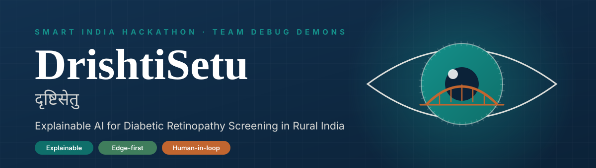
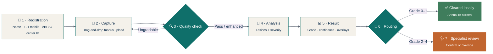
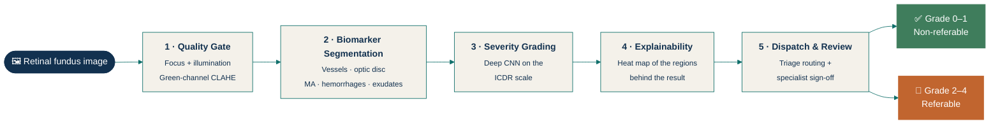
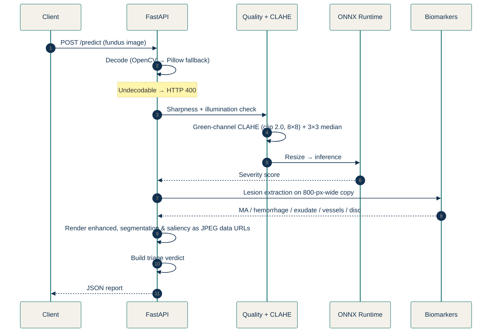
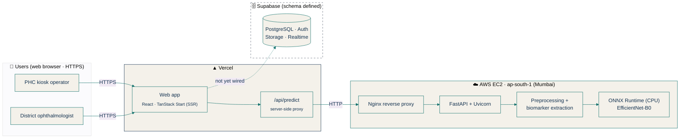

<!-- ═══════════════════════════════════════════════════════════════════════ -->
<!--  SMART INDIA HACKATHON — TEAM DEBUG DEMONS                              -->
<!-- ═══════════════════════════════════════════════════════════════════════ -->

<div align="center">

### 🏆 SMART INDIA HACKATHON &nbsp;·&nbsp; TEAM **DEBUG DEMONS**

<table>
  <tr>
    <td align="center"><b>Dhruv Rane</b></td>
    <td align="center"><b>Monish Fodse</b></td>
    <td align="center"><b>Harsh Bhosale</b></td>
    <td align="center"><b>Payal Shirgire</b></td>
    <td align="center"><b>Shravni More</b></td>
  </tr>
</table>

<br/>



<br/>

**A bridge between the village clinic and the eye specialist.**
*Screen at the point of care. Explain every result. Escalate only what matters.*

<br/>


<br/>

[**The Problem**](#-the-problem) ·
[**Our Solution**](#-our-solution) ·
[**Pipeline**](#-the-five-stage-pipeline) ·
[**AI Model**](#-the-ai-model) ·
[**Performance**](#-reported-performance) ·
[**Architecture**](#-system-architecture) ·
[**Run it**](#-getting-started) ·
[**Roadmap**](#-honest-status--roadmap)

</div>

---

## 📑 Table of Contents

<details open>
<summary><b>Jump to a section</b></summary>

1. [The Problem](#-the-problem)
2. [Our Solution](#-our-solution)
3. [End-to-End Workflow](#-end-to-end-workflow)
4. [The Five-Stage Pipeline](#-the-five-stage-pipeline)
5. [ICDR Severity Scale & Triage](#-icdr-severity-scale--triage)
6. [The AI Model](#-the-ai-model)
7. [Reported Performance](#-reported-performance)
8. [Web Application](#-web-application)
9. [Backend Service & API](#-backend-service--api)
10. [System Architecture](#-system-architecture)
11. [Data Layer & Access Control](#-data-layer--access-control)
12. [Tech Stack](#-tech-stack)
13. [Getting Started](#-getting-started)
14. [Design System](#-design-system)
15. [Expected Impact](#-expected-impact)
16. [Honest Status & Roadmap](#-honest-status--roadmap)
17. [Datasets & Acknowledgements](#-datasets--acknowledgements)
18. [Team Debug Demons](#-team-debug-demons)
19. [Disclaimer](#%EF%B8%8F-disclaimer)

</details>

---

## 🎯 The Problem

<div align="center">

| 🩸 **77 M+** | 👁️ **~18%** | 🛡️ **90%** | 🩺 **1 : 100,000** |
|:---:|:---:|:---:|:---:|
| adults in India living with diabetes | of them affected by diabetic retinopathy | of vision loss preventable with timely screening & referral | ophthalmologist per rural residents |

<sub>Figures as stated in the project's research material, citing the ICMR-INDIAB study and NPCB&VI (Ministry of Health and Family Welfare).</sub>

</div>

Manual fundus examination by specialists simply doesn't scale to rural India, so patients are screened **late or never**. Existing AI screening tools stumble in this setting for four practical reasons:

| | Limitation | Why it hurts |
|---|---|---|
| 🕳️ | **Opaque results** | Clinicians can't see *why* an image was flagged, so trust and adoption suffer. |
| 📷 | **Poor field image quality** | Portable, non-mydriatic (undilated) cameras in camps produce blurred or poorly lit captures (up to ~25% per the project) which models often misclassify. |
| 📶 | **Limited connectivity** | Cloud-only systems stall where cellular coverage is unreliable. |
| 🧑‍⚕️ | **Specialist overload** | Doctors spend time on normal eyes instead of the cases that need them. |

---

## 💡 Our Solution

**DrishtiSetu** (*दृष्टिसेतु* — "bridge of vision") is an **explainable tele-ophthalmology platform**. A health worker at a Primary Healthcare Centre (PHC) or rural mobile camp uploads a fundus photograph. The system **checks quality → measures lesions → estimates severity → shows its evidence → sends only the cases that need attention** to a district ophthalmologist for confirmation.

Every design choice answers one of the problems above:

| Problem | Design response | How it works |
|---|---|---|
| 📷 Field image quality | **Quality Gate** | Scores focus & illumination on every image, enhances contrast, and requests a recapture when the image can't be graded. |
| 🕳️ Opaque results | **Visual Explainability** | Every grade ships with a heat map, a lesion segmentation overlay, and numeric biomarkers (microaneurysm & hemorrhage counts, exudate burden, vessel density). |
| 📶 Limited connectivity | **Two-tier Edge Processing** | Triage runs locally at the PHC; referable cases are queued and synced to the district hospital when a connection is available (store-and-forward). |
| 🧑‍⚕️ Specialist workload | **Intelligent Triage** | Only Grade 2+ and ungradable captures reach specialists; non-referable patients are cleared locally. |
| ⚖️ Clinical accountability | **Specialist Validation Loop** | The ophthalmologist confirms or overrides the AI grade, targeted at **under 30 seconds per case**. |

> **AI assists. Humans decide.** DrishtiSetu is built as a triage aid with a clinician always in the loop, never as a replacement for one.

---

## 🧭 End-to-End Workflow



---

## 🔬 The Five-Stage Pipeline

Every image passes through the **same five sequential stages**, each depending on the one before it.



| # | Stage | Purpose | Method | Output |
|:-:|---|---|---|---|
| **1** | **Quality Gate** | Reject or improve unusable images | Edge-sharpness & illumination checks; **CLAHE** on the green channel (Rayleigh distribution, 8×8 tiles) then a 3×3 median filter | Pass / recapture decision; enhanced image |
| **2** | **Biomarker Segmentation** | Locate anatomy and lesions *deterministically* | 12-orientation linear morphology (vessels) · Gaussian-filtered red–green map (optic disc) · bottom-hat transform (microaneurysms 3–35 px, blot hemorrhages 36–500 px) · top-hat transform (hard exudates) | Lesion counts, exudate burden, vessel density, segmentation overlay |
| **3** | **Severity Grading** | Estimate DR severity | Deep CNN on the ICDR scale ([details](#-the-ai-model)) | Severity result + confidence |
| **4** | **Explainability** | Show what drove the result | Grad-CAM from the final conv layer in the MATLAB pipeline; a lesion-weighted saliency map in the web service | Heat-map overlay |
| **5** | **Dispatch & Review** | Route the case, keep a clinician in the loop | Grade-based triage, priority tags, compact data packet, specialist confirm/override | Priority tag, payload, signed-off grade |

### 🧪 Quality-check & biomarker rules

<details>
<summary><b>Click to expand the exact thresholds</b></summary>

| Item | Rule |
|---|---|
| **Sharpness** | Mean Sobel gradient magnitude × 100 must be **≥ 0.8** |
| **Illumination** | Mean gray level between **25 and 230** (out of 255) |
| **Field of view** | Gray level > 15, closed with a 15×15 kernel, eroded by a 5% margin |
| **Optic disc** | Peak of a Gaussian-filtered red × green map; radius = 7% of the smaller image dimension |
| **Vessels** | Line openings at 12 orientations (15° steps); top 13% of responses inside the field of view |
| **Microaneurysms** | Dark candidates from a bottom-hat transform (threshold 0.065 of full scale), area **3–35 px**, outside vessels & optic disc |
| **Hemorrhages** | Same candidates with area **> 35 and ≤ 500 px** |
| **Hard exudates** | Bright structures from a top-hat transform above 0.11 of full scale; optic disc excluded |

</details>

---

## 🚦 ICDR Severity Scale & Triage

| Grade | Stage | Typical findings | Triage |
|:-:|---|---|---|
| **0** | No apparent retinopathy | No visible signs |  |
| **1** | Mild NPDR | Microaneurysms only |  |
| **2** | Moderate NPDR | Hemorrhages, hard exudates |  |
| **3** | Severe NPDR | 4-2-1 rule: >20 hemorrhages per quadrant, venous beading |  |
| **4** | Proliferative DR | Neovascularization, pre-retinal hemorrhage |  |

### Triage routing rules

| Grade | Status | Queue priority | Action | Payload |
|:-:|---|---|---|:-:|
| **0–1** | ✅ Non-referable, local clearance | **P3** · annual re-screen | Archive locally; discharged at the PHC | 0.00 MB |
| **2–3** | 🟠 Referral required | **P2** · routine specialist queue | Uplink to district hospital | 0.65 MB |
| **4** | 🔴 Emergency: proliferative DR | **P1** · emergency review | Uplink to vitreoretinal surgeon | 1.20 MB |

<sub>Upload time is estimated by simulation, assuming a 1.5 Mbps cellular uplink.</sub>

---

## 🧠 The AI Model

The severity model ships as a **single ONNX file**; the specifications below were read directly from it.

| Property | Value |
|---|---|
| **File** | `efficientnet_b0_regression_512px.onnx` |
| **Size** | 16.0 MB (16,018,283 bytes) |
| **Format** | ONNX, exported from PyTorch |
| **Architecture** | EfficientNet-B0 backbone (conv stem, seven MBConv stages with squeeze-and-excitation, SiLU/Swish) + final linear layer |
| **Input** | `image` · `[batch, 3, 512, 512]` · float32 · variable batch |
| **Output** | `logits` · `[batch, 1]` · float32 — one continuous score per image (**regression formulation**) |
| **Parameters** | ~4 million (estimated from file size at float32) |
| **Runtime** | Loads and runs in ONNX Runtime on **CPU** |

**Why this model?**

- 🔎 **Higher input resolution** — 512×512 keeps more fine retinal detail than a 224×224 model.
- 🪶 **Compact** — ~16 MB, ideal for CPU-only servers and edge machines.
- 🎚️ **Single continuous severity score** rather than five class probabilities.

> [!NOTE]
> Parts of the repository (README history, backend code, UI messages) still describe an earlier **ResNet-50 five-class** model (`netra_rakshak.onnx`, 94.5 MB, 224×224). Aligning them with the EfficientNet-B0 regression model is tracked in the [roadmap](#-honest-status--roadmap).

---

## 📈 Reported Performance

Results come from a **MATLAB evaluation on 599 independent samples** drawn from APTOS 2019, IDRiD, DRIVE and Messidor-2.

### Referable-DR triage (Grade ≥ 2)

| Metric | Target | Result | Cases |
|---|:-:|:-:|---|
| **Sensitivity (recall)** | > 90% | **91.44%** | 171 of 187 referable cases escalated |
| **Specificity** | > 85% | **98.06%** | 404 of 412 non-referable cases cleared locally |
| **Overall triage accuracy** | — | **95.99%** | 575 of 599 correctly triaged |
| **Positive predictive value** | — | **95.53%** | 171 of 179 referable flags correct |
| **Negative predictive value** | — | **96.19%** | 404 of 420 local clearances correct |
| **F1 (referable class)** | — | **93.44%** | — |

### Five-class ICDR accuracy

| Grade | Sensitivity | Precision | Correctly graded |
|---|:-:|:-:|:-:|
| 0 · No DR | 97.46% | 97.19% | 346 / 355 |
| 1 · Mild NPDR | 78.95% | 70.31% | 45 / 57 |
| 2 · Moderate NPDR | 72.36% | 87.25% | 89 / 123 |
| 3 · Severe NPDR | 72.00% | 40.91% | 18 / 25 |
| 4 · Proliferative DR | 61.54% | 72.73% | 24 / 39 |
| **Overall** | — | — | **87.15% (522 / 599)** |

> [!IMPORTANT]
> **Read these numbers responsibly.** They were produced by the **MATLAB reference pipeline**, not yet re-validated end-to-end on the deployed EfficientNet-B0 web service. Sample composition (e.g. DRIVE has no DR grades) and one consistent target set are being confirmed. Grades 3–4 have small sample sizes and lower per-class scores, which is exactly why the specialist validation loop exists.

---

## 🖥️ Web Application

A responsive web app serves both the **operator** and the **specialist**, with a clinical, editorial light theme in place of a consumer-app look.

| Screen | Route | Purpose | Data status |
|---|:-:|---|---|
| 🏠 **Home & case inspector** | `/` | Project story, how it works, sample-image demo with original / segmentation / heat-map layers, live image analysis | Bundled samples; uploads via API |
| 📊 **Diagnostic dashboard** | `/dashboard` | Upload a scan → quality gate, four image panes (original, CLAHE, saliency, segmentation), severity, biomarkers, telemedicine dispatch, probability chart | **Live** via API |
| 🏥 **PHC kiosk** | `/kiosk` | Patient registration (name, +91 mobile, ABHA/center ID), drag-and-drop upload, sample-scan shortcut, screening ledger | Analysis live; ledger holds sample records in browser |
| 🩺 **Specialist console** | `/doctor` | Prioritized queue, original-vs-heat-map view, grade dropdown, **Confirm & Sign Off**, **Override AI Grade** | Sample queue in browser |
| 🔐 **Sign-in** | `/login` | Role choice (kiosk operator / specialist) opens the matching screen | Role selector; auth not yet connected |
| 📚 **Technical page** | `/research` | Long-form problem, pipeline, targets & edge deployment | Static content |

**Client-side upload optimization.** Before upload the browser downsizes each image to **≤ 1600 px** on its longest side and re-encodes it as **JPEG (q = 0.88)**. Portable fundus cameras often emit 5–15 MB files; this keeps uploads reliable on rural connections.

---

## ⚙️ Backend Service & API

Inference is served by a **FastAPI** app (`backend/main.py`, v2.0.0) running under **Uvicorn**.

| Endpoint | Method | Description |
|---|:-:|---|
| `/health` | `GET` | Liveness check; reports whether the model is loaded |
| `/predict` | `POST` | Accepts `multipart/form-data` with a `file` field (JPEG/PNG fundus image); returns the full diagnostic report |

### What happens inside `/predict`



### Response contents

| Field | Contents |
|---|---|
| `icdr_level`, `icdr_grade`, `confidence_percent`, `predictions`, `confidences` | Severity result and per-class probabilities |
| `iqa` | Sharpness, mean illumination, pass flag, decision text |
| `biomarkers` | Microaneurysm & hemorrhage counts, exudate pixels & burden, vessel density, optic-disc position & radius, field-of-view area |
| `visuals` | CLAHE-enhanced image, segmentation overlay, saliency overlay |
| `verdict` | Triage status, queue priority, transmission action, payload size, network latency, referable & urgent flags |
| `execution_time_ms` | Server processing time |

<details>
<summary><b>Example request</b></summary>

```bash
curl -X POST "$NETRA_BACKEND_URL/predict" \
  -F "file=@sample_fundus.jpg"
```

</details>

---

## 🏗️ System Architecture



### Why a server-side proxy?

Browsers block direct **HTTP** calls from **HTTPS** pages (mixed content). The `/api/predict` function (`api/predict.ts`) receives the upload on the Vercel origin and forwards it to the EC2 service, with a **60 s** limit for predictions and **5 s** for health checks. This avoids buying a domain and TLS certificate for the backend. The backend address is configurable via `NETRA_BACKEND_URL`.

### Infrastructure

| Property | Value |
|---|---|
| **Instance** | AWS EC2 `t3.small` (2 vCPU, 2 GB RAM) |
| **Region** | `ap-south-1` (Mumbai), chosen for low latency from Indian PHCs |
| **OS** | Ubuntu 22.04 LTS |
| **Storage** | 20 GB gp3 SSD |
| **Services** | FastAPI + Uvicorn (2 workers) behind Nginx (port 80 → 8000) |
| **Process manager** | systemd service `netra-rakshak.service`, enabled on boot |
| **Provisioning** | `backend/setup.sh` installs Python 3.11 + Nginx, backend deps, downloads the model, registers the service |

---

## 🗄️ Data Layer & Access Control

A **Supabase (PostgreSQL)** schema lives in `supabase/migrations` for storing screenings and controlling access.

| `screenings` field | Purpose |
|---|---|
| `patient_name`, `contact_number`, `abha_id` | Patient identification |
| `image_path` | Fundus image location in storage |
| `ai_grade` | Grade produced by the AI |
| `status` | `pending_review` or `verified` |
| `final_grade`, `doctor_notes` | Specialist's signed-off grade and notes |
| `verified_by`, `verified_at` | Which specialist verified, and when |
| `created_by`, `created_at` | Kiosk user and timestamp |

- 👤 **Roles** — `admin`, `doctor`, `kiosk` (in `user_roles`).
- 🔒 **Row-level security** — Kiosk users create and view their own screenings; doctors view every screening and update it to verify.
- 🖼️ **Image storage** — `fundus-scans` bucket, per-user folders, policies limiting viewing to the uploader and doctors.
- ⚡ **Realtime** — Live updates on `screenings` so the specialist queue refreshes as new cases arrive.

---

## 🧰 Tech Stack

| Layer | Technologies |
|---|---|
| **Frontend** | React 19 · TypeScript · TanStack Start (SSR) & Router · Vite · Tailwind CSS v4 · Radix UI · Lucide · Recharts · React Hook Form + Zod |
| **Backend** | Python 3.11 · FastAPI · Uvicorn (2 workers) · ONNX Runtime (CPU) · OpenCV · NumPy · Pillow |
| **AI & signal processing** | EfficientNet-B0 (ONNX, PyTorch export) · MATLAB R2026a (Image Processing, Computer Vision, Deep Learning toolboxes) for the reference pipeline |
| **Data & auth** | Supabase: PostgreSQL · Auth · Storage · Realtime |
| **Hosting** | Vercel (frontend + serverless proxy) · AWS EC2 t3.small, Mumbai · Nginx · systemd |
| **Tooling** | Bun & npm · ESLint · Prettier · TypeScript 5.8 |

---

## 🚀 Getting Started

### Prerequisites

- **Node.js** (or **Bun**) for the frontend
- **Python 3.11** for the backend
- The model file `efficientnet_b0_regression_512px.onnx`

### 1 · Clone

```bash
git clone <your-repo-url>
cd drishtisetu
```

### 2 · Run the inference backend

```bash
cd backend
python3.11 -m venv .venv && source .venv/bin/activate
pip install fastapi uvicorn onnxruntime opencv-python-headless numpy pillow python-multipart

# place efficientnet_b0_regression_512px.onnx where backend/main.py expects it, then:
uvicorn main:app --host 0.0.0.0 --port 8000 --workers 2
```

> On a fresh server, skip the manual steps: `backend/setup.sh` installs everything and registers the systemd service.

Verify it's alive:

```bash
curl http://localhost:8000/health
```

### 3 · Run the frontend

```bash
# from the repo root
bun install        # or: npm install
echo "NETRA_BACKEND_URL=http://localhost:8000" > .env
bun run dev        # or: npm run dev
```

Open the local URL and try `/kiosk` or `/dashboard` with a fundus image.

| Script | What it does |
|---|---|
| `dev` | Start the Vite dev server |
| `build` | Production build (`build:dev` for a development-mode build) |
| `preview` | Preview the production build locally |
| `lint` | Run ESLint |
| `format` | Format the codebase with Prettier |

### 4 · Deploy

| Piece | How |
|---|---|
| **Backend** | Provision an Ubuntu 22.04 EC2 in `ap-south-1`, then run `backend/setup.sh` (installs Python 3.11 + Nginx, deps, model download, systemd service). |
| **Frontend** | Deploy to **Vercel** and set `NETRA_BACKEND_URL` to the EC2 address; the `/api/predict` proxy handles the HTTPS→HTTP hop. |

---

## 🎨 Design System

A **medical-journal register**: restrained, high-contrast, evidence-led. Headings in **Source Serif 4**, body in **Inter**. Imagery is *real pipeline output*, never stock graphics, and gradients aren't used for decoration. **Amber and green appear only to signal referable and non-referable results.**

| Swatch | Token | Hex | Use |
|:-:|---|:-:|---|
|  | **Ink** | `#12314F` | Primary text, headings, navigation |
|  | **Teal** | `#0F6F6A` | Primary accent: links, buttons, active states |
|  | **Paper** | `#FFFFFF` | Primary background |
|  | **Paper alt** | `#F4F1EA` | Alternating section background |
|  | **Gray** | `#5B6472` | Secondary text |
|  | **Gray line** | `#DDD8CC` | Dividers and table hairlines |
|  | **Amber** | `#C1652F` | Reserved: referable-DR & alerts |
|  | **Green** | `#3F7D5C` | Reserved: no-referral & healthy |

---

## 🌍 Expected Impact

| | Impact | Detail |
|---|---|---|
| 🏥 | **Screening where specialists are absent** | Quality checking and first-line triage run at the PHC. |
| ⏱️ | **Specialist time, focused** | Only Grade 2+ and ungradable captures join the queue; review targeted at < 30 s. |
| 📉 | **Low bandwidth** | Referable cases travel as a compact **0.65 MB** packet (roughly **92% smaller** than an 8.5 MB full image); non-referable cases need no uplink. |
| 🔗 | **Continuity of care** | Records are designed to link to the patient's **ABHA** (Ayushman Bharat Health Account) ID. |
| 🔐 | **Secure store-and-forward** | Referable images are designed to be encrypted (AES-256) and queued until a connection is available. |

---

## 🧭 Honest Status & Roadmap

We'd rather be transparent than impressive. DrishtiSetu is a **working prototype**; this is exactly where it stands.

### ✅ Working today

- [x] Quality gate, CLAHE enhancement and deterministic biomarker segmentation
- [x] EfficientNet-B0 ONNX model loading and CPU inference
- [x] Live `/predict` API with visual outputs and triage verdict
- [x] Vercel proxy → EC2 deployment (Mumbai)
- [x] Full responsive UI: home, dashboard, kiosk, specialist console, research page
- [x] Supabase schema with roles, row-level security, storage policies, realtime

### 🛠️ In progress / next

- [ ] **Align backend with the EfficientNet-B0 regression model** (single-score output, 512×512 input) and update the response format
- [ ] **Define score → grade thresholds** and confidence calibration
- [ ] **Confirm input normalization** used in training (scaled vs raw 0–255)
- [ ] **True Grad-CAM in the web service** (today it returns a lesion-weighted saliency map because the ONNX file exposes no gradients)
- [ ] **Re-validate performance** on the deployed model with a documented sample set and one consistent target set
- [ ] **Wire the UI to Supabase**: real auth, persisted screenings, live specialist queue
- [ ] **Lock down role self-registration** before any real patient data is used
- [ ] Offline-first store-and-forward sync at the PHC
- [ ] Custom domain + TLS for the backend

### 🧪 Prototype behavior to be aware of

- The specialist queue and kiosk ledger use **sample data in the browser**.
- `/login` is a **role selector**; authentication is not yet connected.
- No screen reads from or writes to Supabase yet.

---

## 📚 Datasets & Acknowledgements

| Dataset | Role in the project |
|---|---|
| **APTOS 2019** | Field captures from Indian tele-screening camps; primary training cohort |
| **IDRiD** | Indian dataset with pixel-level microaneurysm, hemorrhage and exudate ground truth |
| **DRIVE** | Vessel segmentation benchmark (20 test subjects) |
| **Messidor-2** | Multi-center cohort used to check generalization |
| **EyePACS** | Listed as training data |

Statistics cited from the **ICMR-INDIAB study** and **NPCB&VI, Ministry of Health and Family Welfare, Government of India**. Grading follows the **International Clinical Diabetic Retinopathy (ICDR)** severity scale.

---

## 👥 Team Debug Demons

<div align="center">

**Smart India Hackathon · Team _Debug Demons_**

| 👤 | 👤 | 👤 | 👤 | 👤 |
|:-:|:-:|:-:|:-:|:-:|
| **Dhruv Rane** | **Monish Fodse** | **Harsh Bhosale** | **Payal Shirgire** | **Shravni More** |

*We build bridges, then debug them until they hold.* 🌉

</div>

---

## ⚕️ Disclaimer

DrishtiSetu is a **research and hackathon prototype** intended to demonstrate AI-assisted triage. It is **not a certified medical device** and must **not** be used as the sole basis for any clinical decision. All AI grades require confirmation by a qualified ophthalmologist, and the system must be independently clinically validated and appropriately regulated before any use with real patients.

<div align="center">
<br/>

**दृष्टिसेतु — Because no one should lose their sight to a problem we can screen for.**

<sub>Made with ☕ and stubborn debugging by Team Debug Demons</sub>

</div>
